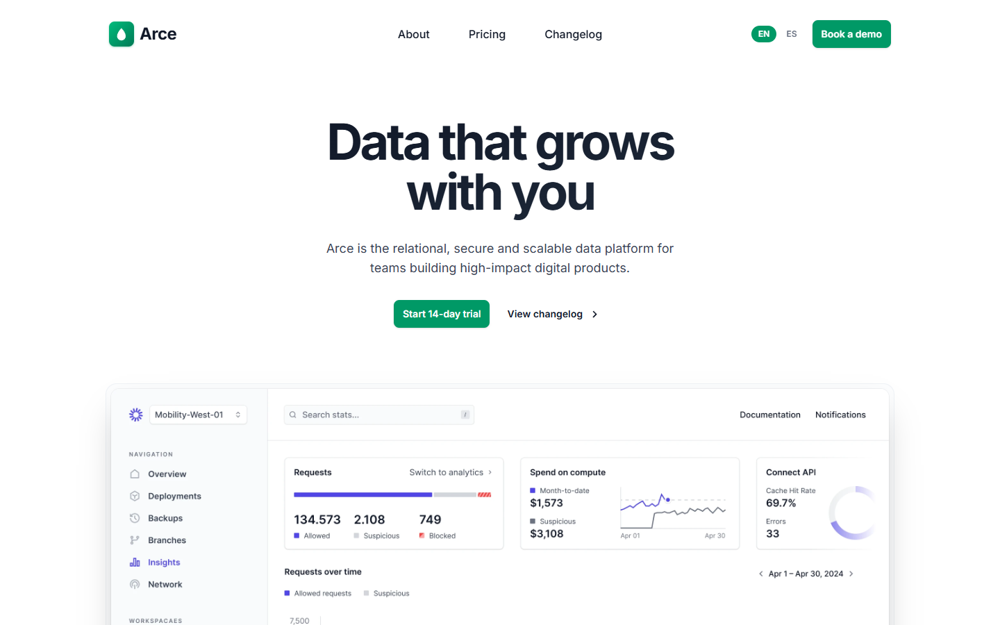

# Arce

**Data that grows with you.**

Arce is a relational data platform for product teams — a production-ready marketing site and SaaS landing page built with Next.js, TypeScript, Tailwind CSS v4 and Tremor. It ships with full internationalization (English and Spanish), search-engine optimization, and a clean component architecture that is easy to rebrand and extend.

> 🇪🇸 *Arce es una plataforma de datos relacional para equipos de producto: un sitio de marketing y landing SaaS listo para producción, con internacionalización (inglés y español) y SEO integrados.*



---

## Features

- **Internationalized by default** — English and Spanish, with URL-based routing (`/en`, `/es`), browser-language detection, and a locale cookie. English is the default locale.
- **SEO-ready** — canonical URLs, `hreflang` alternates, Open Graph and Twitter cards, dynamic `opengraph-image`, `sitemap.xml`, `robots.txt`, and JSON-LD structured data (`Organization`).
- **Dark mode** — class-based theming with `next-themes` and a persistent light/dark toggle.
- **Marketing sections** — hero, logo cloud, animated globe (`cobe`), code examples (`shiki`), features, testimonials, FAQs, team gallery, benefits, and CTA.
- **Pricing page** — three USD tiers (Starter, Teams, Business) with monthly/annual toggle.
- **Changelog & About pages** — static, localized pages.
- **Self-hosted assets** — all images and fonts are served from `public/`, no external CDN dependencies.
- **Type-safe** — strict TypeScript throughout; `pnpm typecheck` is part of the workflow.

## Tech stack

| Layer | Technology |
| --- | --- |
| Framework | [Next.js](https://nextjs.org) 16 (App Router, Turbopack) |
| Language | [TypeScript](https://www.typescriptlang.org) 5.7 |
| Styling | [Tailwind CSS](https://tailwindcss.com) v4 |
| Components | [Tremor](https://tremor.so), [shadcn/ui](https://ui.shadcn.com), [Radix UI](https://www.radix-ui.com) |
| Motion | [cobe](https://github.com/shuding/cobe), CSS keyframe animations |
| Theming | [next-themes](https://github.com/pacocoursey/next-themes) |
| Package manager | [pnpm](https://pnpm.io) |

## Getting started

### Prerequisites

- Node.js 20 or later
- pnpm 9 or later

### Install

```bash
pnpm install
```

### Environment variables

| Variable | Required | Default | Description |
| --- | --- | --- | --- |
| `NEXT_PUBLIC_SITE_URL` | No | `https://arce-data.vercel.app` | Canonical origin used for metadata, canonical links, `hreflang`, sitemap, robots and Open Graph URLs. Set it to your production domain. |

### Develop

```bash
pnpm dev
```

Open [http://localhost:3000](http://localhost:3000). Requests are redirected to `/en` (or your browser language) by the `proxy.ts` middleware.

### Production build

```bash
pnpm build
pnpm start
```

### Type checking

```bash
pnpm typecheck
```

## Internationalization

Arce is bilingual out of the box: **English** (default) and **Spanish**.

- **Routing** — every page lives under `app/[locale]/`, so routes are `/en`, `/es`, `/en/pricing`, and so on.
- **Detection** — `proxy.ts` reads the `ARCE_LOCALE` cookie, then the browser's `Accept-Language` header, falling back to `en`.
- **Dictionaries** — copy lives in `i18n/dictionaries/{en,es}.ts`. The English file is the source of truth; every locale must satisfy the exported `Dictionary` type.
- **Switcher** — `components/LocaleSwitcher.tsx` renders the language toggle in the navbar and footer.

### Adding a locale

1. Create `i18n/dictionaries/<code>.ts` implementing the `Dictionary` type.
2. Add the code to the `locales` array in `i18n/config.ts`.

```ts
export const locales = ["en", "es", "de"] as const;
```

## Region & currency

Arce targets a **global B2B audience** with **USD** pricing. The fictional company is headquartered in Zürich, Switzerland (`Arce Data AG`). Adjust `config/site.ts` and the pricing dictionaries to localize region, currency, and legal details.

## Project structure

```
.
├── app/
│   ├── [locale]/          # localized pages (layout, home, about, pricing, changelog)
│   ├── globals.css        # Tailwind v4 theme, dark variant, fonts
│   ├── icon.svg
│   ├── robots.ts
│   └── sitemap.ts
├── components/            # UI primitives and section components
├── config/site.ts         # brand, domain, and site metadata
├── i18n/                  # locale config and dictionaries
├── lib/                   # seo helpers and utilities
├── public/                # self-hosted images and fonts
└── proxy.ts               # locale detection middleware
```

## License

Copyright (c) 2026 Arce. All rights reserved. Proprietary — see [LICENSE](./LICENSE).

This project is derived from the open-source Tremor template (MIT). See [THIRD-PARTY-NOTICES.md](./THIRD-PARTY-NOTICES.md) for attribution.
